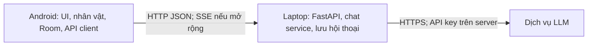

# Đề xuất dự án: Trợ lý ảo Android với nhân vật 2D

**Quy chuẩn triển khai cho nhóm 4 người — 28/09/2026**  
**Môn học:** Lập trình Android nâng cao

## 1. Ý tưởng và sản phẩm cần bàn giao

Người dùng trò chuyện bằng văn bản với một trợ lý ảo trên điện thoại Android. Một nhân vật phong cách anime hiển thị trong ứng dụng và thay đổi trạng thái khi chờ, xử lý hoặc trả lời. Android gửi yêu cầu đến backend chạy trên laptop; backend gọi dịch vụ LLM qua API và trả kết quả về ứng dụng. Nhóm dùng Krita để vẽ nhân vật 2D; bản đầu dùng ảnh hoặc animation ngắn, chưa cần Live2D.

**Luồng trình diễn cuối kỳ:** mở app → bắt đầu cuộc trò chuyện → gửi câu hỏi → thấy nhân vật đang suy nghĩ → nhận câu trả lời và biểu cảm → thoát/mở lại app vẫn xem được lịch sử → tạo cuộc trò chuyện mới hoặc xóa cuộc cũ.

### Phạm vi bắt buộc (MVP)

| Mã | Use case | Dấu hiệu đạt |
| --- | --- | --- |
| UC01 | Trò chuyện văn bản | Gửi tin nhắn, nhận câu trả lời từ LLM qua backend; hiển thị lỗi và cho phép thử lại khi mạng/API lỗi. |
| UC02 | Trạng thái nhân vật | Thấy `idle → thinking → talking → idle` đúng theo tiến trình yêu cầu. `talking` là trạng thái hiển thị câu trả lời; bản MVP chưa bắt buộc phát giọng nói. |
| UC03 | Biểu cảm | Hiển thị ít nhất `neutral`, `happy`, `sad`, `surprised` theo giá trị backend trả; giá trị lạ trở về `neutral`. |
| UC04 | Lịch sử | Xem danh sách và mở lại cuộc trò chuyện cùng các tin nhắn sau khi khởi động lại app. |
| UC05 | Quản lý cuộc trò chuyện | Tạo chat mới; xóa một chat có xác nhận; chat khác không bị ảnh hưởng. |
| UC10 | Cài đặt cơ bản | Xem/sửa địa chỉ backend, kiểm tra kết nối; lưu địa chỉ cho lần mở sau. |

**Sau MVP, nếu còn thời gian:** thêm streaming trước; tiếp theo mới đến nhập bằng giọng nói, đọc câu trả lời, nhớ thông tin giữa các chat, tool calling và nhắc việc. Không đưa microphone hoặc tùy chọn TTS chưa hoạt động lên giao diện MVP.

## 2. Màn hình và luồng sử dụng

| Màn hình | Nội dung và thao tác chính |
| --- | --- |
| Home | Nhân vật, nút Bắt đầu trò chuyện, Lịch sử, Cài đặt. |
| Chat | Nhân vật ở phía trên, danh sách tin nhắn, ô nhập và nút Gửi, trạng thái đang xử lý, nút Chat mới, đường đến Lịch sử. Khi bàn phím mở vẫn thấy được ô nhập. |
| History | Danh sách chat (tiêu đề/tin nhắn đầu, thời gian), mở lại, xóa có xác nhận. |
| Settings | Địa chỉ backend và nút kiểm tra kết nối; các thiết lập voice chỉ xuất hiện nếu đã triển khai. |

Không có màn Character riêng. Giữ đủ bốn màn Home, Chat, History, Settings. Từ History mở Chat với `conversation_id` đã chọn; nút Chat mới tạo `conversation_id` mới. Nút Back từ Chat/History/Settings về Home; từ chat được mở qua History, Back về History.

## 3. Kiến trúc và ranh giới trách nhiệm



- **Android:** Kotlin + Jetpack Compose + Navigation Compose + ViewModel/Repository; Room lưu bản sao hội thoại để xem khi mở lại; Retrofit/OkHttp gọi HTTP JSON. Một repository quản lý lưu và đồng bộ chat. Android không giữ API key LLM.
- **Backend:** Python + FastAPI + SQLite; kiểm tra đầu vào, quản lý các cuộc trò chuyện; gọi mô-đun AI, trả lỗi có cấu trúc. Backend là nguồn dữ liệu chính của hội thoại; Room là cache đọc khi offline. Khi có mạng, tải lại danh sách/chat từ server và cập nhật Room; khi offline, hiển thị lịch sử cache nhưng không cho tạo/xóa chat hoặc gửi tin nhắn.
- **AI:** Dùng OpenAI API qua một service riêng trong backend; model chọn bằng biến môi trường `OPENAI_MODEL` (tên model điền trong `.env` khi nhóm có tài khoản API). Service nhận câu hỏi + tối đa 10 tin nhắn trước đó của đúng cuộc chat, gọi LLM, kiểm tra/chuẩn hóa `emotion`; nếu thiếu emotion dùng `neutral`, nếu thiếu câu trả lời báo lỗi. System prompt yêu cầu trả lời tiếng Việt, rõ ràng, không tự nhận đã thực hiện thao tác trên điện thoại/laptop khi chưa có tool.
- **Mạng demo:** điện thoại và laptop dùng cùng Wi-Fi; app trỏ đến IP LAN của laptop, cổng `8000`. `localhost` trên điện thoại là điện thoại, không phải laptop. Trên emulator Android dùng `10.0.2.2`. Laptop bật server lắng nghe `0.0.0.0:8000` và cho phép cổng qua firewall; cần Internet để gọi LLM.

### Hợp đồng API cố định cho MVP

Prefix `/api/v1`; mọi request chat dùng `Content-Type: application/json` và header `X-Client-Id: <UUID>` (UUID tạo một lần trên Android, lưu qua DataStore). Mọi ID là UUID dạng chuỗi; thời gian là UTC ISO 8601 với hậu tố `Z`. Backend lọc mọi conversation/message theo client ID. Phản hồi danh sách bọc trong `{"items":[...]}`. Text không rỗng sau trim, tối đa 2000 ký tự. Với cùng một yêu cầu gửi lại do timeout, Android gửi cùng `request_id` UUID; backend trả lại kết quả cũ nếu đã xử lý để không tạo tin nhắn kép.

| Method/path | Mục đích | Kết quả chính |
| --- | --- | --- |
| `GET /health` | Kiểm tra laptop có sẵn sàng | `{"status":"ok"}`; không cần header client |
| `POST /conversations` | Tạo chat mới | `{"id":"<UUID>","title":"Cuộc trò chuyện mới","created_at":"...Z","updated_at":"...Z"}` |
| `GET /conversations` | Danh sách chat | `{"items":[{"id":"...","title":"...","created_at":"...Z","updated_at":"...Z"}]}` theo `updated_at` mới nhất |
| `GET /conversations/{id}/messages` | Xem tin nhắn cũ | `{"items":[{"id":"...","role":"user","text":"...","emotion":null,"created_at":"...Z"}]}` theo thời gian cũ nhất |
| `DELETE /conversations/{id}` | Xóa chat và tin nhắn | HTTP `204` |
| `POST /conversations/{id}/messages` | Gửi text và nhận câu trả lời | HTTP `200`, `user_message` và `assistant_message` |

Ví dụ gửi và nhận:

```json
{"request_id":"d4a4a5e3-90e3-4d82-8d5d-415ca3024300","message":"Xin chào"}
```

```json
{
  "user_message": {"id":"718a0d38-dafc-42bb-b72d-1733ee467ed7","role":"user","text":"Xin chào","emotion":null,"created_at":"2026-09-28T01:00:00Z"},
  "assistant_message": {"id":"71f955ed-a03d-4f34-b7dd-7f345e4940c8","role":"assistant","text":"Chào bạn!","emotion":"happy","created_at":"2026-09-28T01:00:02Z"}
}
```

UI tự điều khiển `idle/thinking/talking` theo vòng đời request; backend chỉ quyết định **emotion của phản hồi**. Tập emotion cố định: `neutral`, `happy`, `sad`, `surprised`. `talking` là animation kéo dài khoảng 2 giây khi hiện câu trả lời, rồi về `idle`; không hàm ý đang phát giọng nói. Chuẩn lỗi `{"error":{"code":"LLM_UNAVAILABLE","message":"Không thể kết nối AI"}}`: HTTP `400` nội dung sai, `404` chat không tồn tại/không thuộc client, `503` LLM lỗi, `504` quá thời gian. Chỉ lưu cặp tin nhắn hoàn chỉnh trên server sau khi LLM trả thành công; nếu lỗi, UI giữ bản nháp và cùng `request_id` để thử lại.

## 4. Nhiệm vụ cụ thể cho 4 thành viên

Các ký hiệu **A–D là vai trò tạm**; nhóm chỉ việc điền tên. Mỗi người có phần triển khai, đầu ra bàn giao và tiêu chí kiểm thử riêng.

| Vai trò | Việc cần làm | Bàn giao và dấu hiệu đạt |
| --- | --- | --- |
| **A — Android core & dữ liệu** | Tạo project Kotlin/Compose, navigation Home/Chat/History/Settings; UI chat, ô nhập, loading/lỗi; Retrofit API client theo hợp đồng; Room cache, DataStore lưu `client_id` và URL server; tạo/mở/xóa chat. | APK chạy trên điện thoại thật; gửi/nhận từ backend; mở lại thấy lịch sử; tạo và xóa chat đúng; lỗi mất mạng không làm treo app. Có README cách cấu hình IP. |
| **B — Nhân vật & giao diện** | Thiết kế một nhân vật anime 2D bằng Krita, màu chủ đạo xanh lam/trắng, nét dễ nhìn trên nền sáng; xuất PNG nền trong suốt cho `idle`, `thinking`, `talking`, `happy`, `sad`, `surprised`; tích hợp component nhân vật vào Home/Chat; kiểm tra nhiều kích thước màn hình. | Gói asset nguồn `.kra` và 6 PNG xuất cùng khung 1024 × 1024 px; tên `character_<state>.png`; nhân vật đổi trạng thái và biểu cảm trong app, không méo hoặc che ô chat; không cần Live2D. `neutral` dùng ảnh `idle`. |
| **C — Backend & lưu trữ** | Dựng FastAPI, SQLite, các endpoint ở mục 3; schema conversation/message; xử lý lỗi, CORS nếu thật sự cần, timeout và log không chứa API key; chạy qua LAN; viết hướng dẫn chạy server và cấu hình môi trường. | API chạy được trên laptop; `GET /health` từ điện thoại trả OK; tạo/gửi/đọc/xóa chat đúng; restart server không mất dữ liệu; lỗi AI có phản hồi rõ; có lệnh chạy và ví dụ request. |
| **D — Tích hợp LLM** | Viết AI service gọi OpenAI API để C sử dụng; đọc `OPENAI_API_KEY` và `OPENAI_MODEL` từ môi trường; system prompt tiếng Việt cho nhân vật; gửi tối đa 10 tin nhắn trước đó đúng chat; chuẩn hóa emotion; timeout 30 giây, mock AI và báo lỗi rõ. | C gọi service nhận được `reply + emotion`; hỏi tiếp trong cùng chat có ngữ cảnh, chat khác tách biệt; emotion thuộc tập cho phép; key không xuất hiện trong app/repo/log; chế độ mock hoạt động khi chưa có khóa API. |

### Điểm ghép nhóm cần làm sớm

1. **A + C:** triển khai đúng API ở mục 3, UUID/UTC/mã lỗi và `request_id`; C cung cấp mock AI để A ghép app từ mốc M2.
2. **B + A:** dùng quy chuẩn ảnh 1024 × 1024 và tên `character_<state>.png`; B giao bộ ảnh tạm trước mốc M2 để A tích hợp.
3. **D + C:** interface Python `generate_reply(context, message) -> (reply, emotion)`; C chỉ lấy tối đa 10 tin nhắn cùng chat và truyền vào D; D xử lý timeout 30 giây.
4. **Cả nhóm:** cùng chạy một kịch bản demo trên **điện thoại thật** và laptop; mỗi người sửa lỗi trong phần mình phụ trách trước khi nghiệm thu.

## 5. Kế hoạch triển khai và nghiệm thu

| Mốc | Kết quả có thể kiểm tra |
| --- | --- |
| M1 — Nhận vai | Điền tên A–D; mọi người dùng bốn màn và quy chuẩn API/asset trong tài liệu này. |
| M2 — Khung độc lập | Android chuyển màn với dữ liệu giả; nhân vật dùng PNG tạm; backend CRUD dùng SQLite và mock AI; AI service trả câu mẫu. |
| M3 — Tích hợp MVP | Điện thoại thật gửi chat qua Wi-Fi đến laptop; backend gọi LLM; biểu cảm đổi; lịch sử và tạo/xóa chat hoạt động sau khi khởi động lại cả app/server. |
| M4 — Ổn định | Kiểm tra mạng lỗi, API lỗi, chat rỗng, chat dài, đổi IP; sửa giao diện và quay video demo; đóng gói APK, mã nguồn, hướng dẫn chạy, tài liệu API và phân công. |
| M5 — Mở rộng (nếu còn thời gian) | Ưu tiên streaming trước; sau đó voice input/output hoặc một tool đơn giản, mỗi chức năng có kiểm thử riêng. |

**Định nghĩa “MVP hoàn thành”:** Một người ngoài nhóm làm theo README có thể khởi động backend, cấu hình IP trong app, thực hiện toàn bộ UC01–05 và UC10 trên điện thoại; 4 trạng thái/biểu cảm hiển thị đúng; có bản ghi hoặc video các ca thử mạng/API lỗi. Nhóm có thể trình bày rõ việc Android, backend và AI của từng thành viên.

## 6. Quy ước kỹ thuật và rủi ro thực tế

- API key chỉ nằm trong biến môi trường backend (file `.env` không commit). Dùng `.env.example` không chứa khóa thật. Giới hạn chi phí hoặc số lượt gọi API khi demo.
- Vì backend chạy trên laptop, app chỉ chat trực tuyến khi laptop bật và điện thoại kết nối được. Lịch sử đã cache vẫn có thể xem trong app, nhưng thao tác đồng bộ cần server. Với demo qua HTTP trong LAN, chỉ cho phép cleartext ở cấu hình debug và đúng host cần thiết; bản phát hành qua Internet nên dùng HTTPS.
- Không lưu nội dung riêng tư không cần thiết. Trong bản đầu, mỗi bản cài đặt dùng một `client_id` ngẫu nhiên lưu tại Android và gửi kèm mọi request; backend lọc dữ liệu theo `client_id`. Đây chỉ là tách dữ liệu cho demo, **không phải xác thực bảo mật**. Nếu demo một thiết bị duy nhất, nhóm có thể giản lược sau khi ghi rõ giới hạn. Nếu mở truy cập qua Internet hoặc nhiều người dùng, cần đăng nhập/xác thực và HTTPS trước.
- Không bắt đầu đồng thời voice, streaming và tool calling khi đường chat văn bản chưa ổn định. Có mock AI và asset tạm để công việc của một người không chặn cả nhóm.

## 7. Quy chuẩn bàn giao và phân vai

| Vai | Thành viên (điền tên) | Bàn giao chính |
| --- | --- | --- |
| A | __________ | Project Android, APK, hướng dẫn cấu hình server |
| B | __________ | File Krita, 6 PNG, component nhân vật |
| C | __________ | Backend FastAPI, SQLite, API, hướng dẫn chạy |
| D | __________ | AI service, mock AI, `.env.example`, hướng dẫn cấu hình LLM |

**Cấu trúc repo:** `android/` (A và B), `backend/` (C và D), `assets/character/` (B), `docs/` (hợp đồng API, hình chụp/kiểm thử), README.md ở gốc (A/C cùng cập nhật). Mỗi người dùng nhánh `feature/a-android`, `feature/b-character`, `feature/c-backend`, `feature/d-ai`; mở pull request vào `main` khi phần mình chạy được. Không commit `.env`, API key, dữ liệu SQLite thực hoặc file build tạm.

**Chi phí API:** sử dụng một tài khoản API do người đảm nhiệm D cấu hình trên laptop, chỉ chạy gọi thật khi tích hợp hoặc demo; thời gian phát triển dùng mock. Đặt mức giới hạn chi tiêu trong tài khoản API trước khi dùng khóa thật. B dùng asset nhóm tự vẽ, không dùng ảnh nhân vật có bản quyền lấy từ anime.

**Việc duy nhất nhóm cần phân công:** điền tên A–D và tự đặt ngày hoàn thành M1–M4 theo hạn nộp môn học. Các lựa chọn kỹ thuật và hợp đồng tích hợp trong tài liệu này là chuẩn chung của nhóm.

> Nếu giảng viên có yêu cầu bắt buộc khác, cập nhật tài liệu chung trước khi thay đổi code liên quan.
